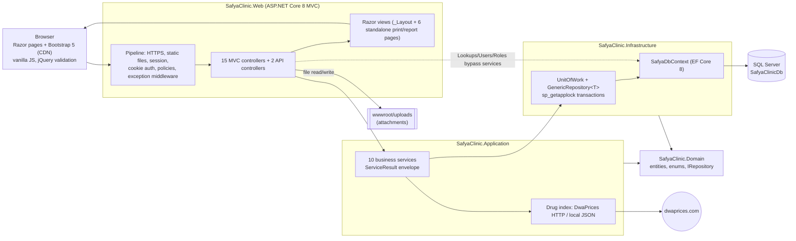

# 02 — Solution Map

Phase 2 deliverable. Repository `MostafaSIbrahim/clinic-MS`, `main` = `e564582` (2026-10-26). Folder sizes and file counts from the working tree; `bin/` and `obj/` excluded.

## Repository layout

```
clinic-MS/
├── SafyaClinic/                         ← the .NET solution (source of truth)
│   ├── SafyaClinic.sln                  4 projects (Domain, Application, Infrastructure, Web)
│   ├── SafyaClinic.Domain/              entities, enums, repository interfaces
│   ├── SafyaClinic.Application/         DTOs, service interfaces + implementations, drug-index integration, seed JSON
│   ├── SafyaClinic.Infrastructure/      DbContext, 27 entity configurations, 13 migrations, repositories, DI
│   ├── SafyaClinic.Web/                 MVC host: Program.cs, 15 MVC + 2 API controllers (+ BaseController), 85 Razor files, wwwroot
│   ├── tests/
│   │   ├── PaymentAccessChecks/         console app, 30 reflection checks on PaymentsController (not in .sln)
│   │   ├── DeploymentChecks/            console app, offline migration/model check (not in .sln)
│   │   └── reservation-patient-picker.test.cjs   Node test runner, 5 tests
│   ├── docs/                            UI/UX guides, payment-access notes, MonsterASP deployment guides,
│   │                                    DeploymentMigrations.sql (generated idempotent script)
│   ├── .vscode/, CHANGES_README.md, .gitignore
├── SafyaClinicPublish/                  29 MB committed publish output (DLLs, appsettings.json, wwwroot)
├── backup/Views/                        old copies of Auth, Dashboard, Home, Shared views
├── Docs/                                Performance-baseline.md; assessment/ (this set)
├── P-Analysis/                          not reviewed (outside the solution)
├── *.docx                               design/plan documents (system overview, DB scheme, optimisation plans)
├── safyaclinic.runasp.net-WebDeploy.publishSettings   Web Deploy credentials file (committed)
├── .github/workflows/                   empty (local only)
└── .gitignore, .gitattributes, .gitatributes (typo, duplicate)
```

## Solution at a glance



## Runtime topology

| Environment | Host | Database | Deploy | Notes |
|---|---|---|---|---|
| Local dev | Kestrel `https://localhost:7131`, `http://localhost:5070` (or IIS Express) on the developer laptop | SQL Server 2025 Developer, `SafyaClinicDb`, Windows auth | `dotnet run` / Visual Studio | Startup runs `Database.Migrate()` and `DbSeeder` |
| Hosted test | MonsterASP `safyaclinic.runasp.net` (`site83728`) | host-provided SQL Server (connection string kept on server) | Visual Studio Web Deploy profile | Dev/test data only (owner confirmed) |
| Public demo | MonsterASP `safyaclinic-demo.runasp.net` (`site89078`) | separate demo database | Web Deploy profile `site89078-WebDeploy.pubxml` | Seeded admin login published intentionally in the demo guide (decision 2026-10-26) |

Publish protection (commit `d6b9d96`): `appsettings*.json` and `wwwroot/uploads/**` are never published, and MSDeploy skip rules preserve them on the server.

## Entry points

| Entry | File | What happens |
|---|---|---|
| Process start | `SafyaClinic.Web/Program.cs` | Registers MVC, infrastructure, application services, cookie auth, 7 policies, session; applies migrations and seeds; builds pipeline; maps default route |
| Anonymous landing | `HomeController.Index` → `Views/Home/Index.cshtml` (standalone, bilingual) | Authenticated users are redirected to `/Dashboard` |
| Sign-in | `AuthController.Login` | Phone + password; cookie issued with role claims |
| JSON endpoints | `GET /api/patients/search`, `GET /api/medicines/search` | Used by `reservation-patient-picker.js` and `medicine-autocomplete.js` |

## Size indicators

| Item | Count |
|---|---|
| C# lines excluding migrations | ≈ 15,000 |
| Largest services | `PaymentService` 1,303 · `ReservationService` 1,262 · `PatientRecordService` 923 · `NutritionService` 876 lines |
| Largest controllers | `ReservationsController` 458 · `MedicalRecordsController` 437 · `LookupsController` 404 lines |
| Largest views | `Patients/Details` 454 · `Home/Index` 337 · `Payments/PatientSummary` 326 · `MedicalRecords/Details` 304 lines |
| CSS / JS | `site.css` 674 lines; 4 JS files (≈ 370 lines) + inline scripts in 21 views |
| Database | 31 tables, 51 FK columns, 101 non-PK indexes, 0 views/procedures |
