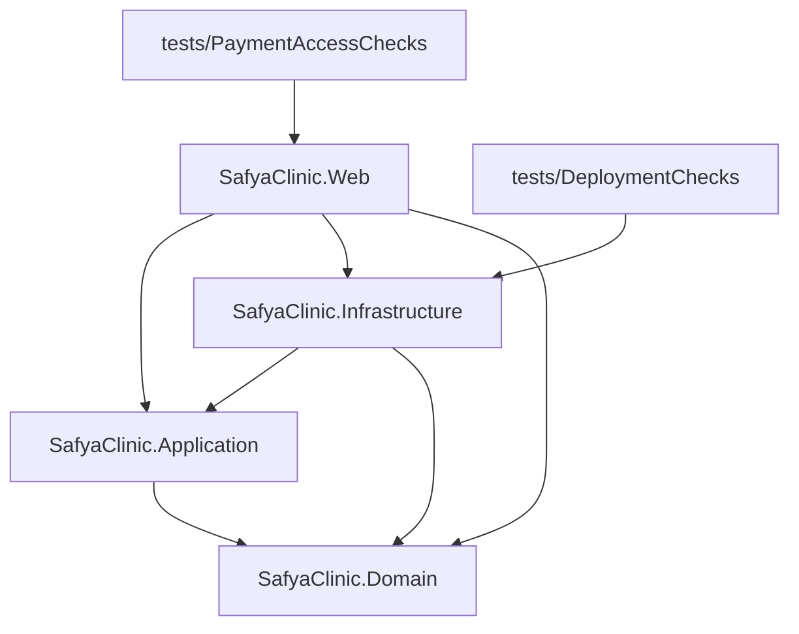

# 03 — Project Responsibility and Dependency Map

Phase 2 deliverable. Sources: `*.csproj`, `using` directives, DI registration, `obj/project.assets.json` (resolved packages), and `dotnet list package` output from 2026-10-26.

## 1. Project responsibilities

| Project | Owns | Main folders / types | Should not own (observed anyway) |
|---|---|---|---|
| **SafyaClinic.Domain** | Business entities and enums; repository contracts | `Entities/{Analysis, Audit, Common, MedicalRecord, Nutrition, Patient, Payment, Prescription, Reservation, Settings}`, `Identity/{User, Role, UserRole}`, `Enums/*` (11), `Interfaces/Repositories/{IRepository, IUnitOfWork, INutritionPackageRepository, IWeeklyFollowUpRepository}` | Persistence concerns: references `Microsoft.EntityFrameworkCore.Abstractions` + `Design`; 2 entity files use EF/data-annotation attributes (e.g. `[ForeignKey("Collector")]` on `Payment.CollectedBy`). `IUnitOfWork` exposes transaction helpers named after use cases (`ExecutePatientPaymentAsync`, `ExecuteReservationRecordAsync`, …) |
| **SafyaClinic.Application** | Use cases and business rules; DTOs; service interfaces; drug-index integration | `Services/*Service.cs` (10), `Services/EgyptianDrugIndex/*`, `DTOs/**` (30 files), `Interfaces/Services/*` (10), `Options/EgyptianDrugIndexOptions`, `Data/egyptian-medicines-seed.json` | Query mechanics: 10 files import `Microsoft.EntityFrameworkCore` and compose LINQ directly on `IRepository<T>.Query()`, including `ExecuteUpdateAsync` / `ExecuteDeleteAsync` bulk operations. Password hashing (`AuthService.HashPassword`) and an unused JWT generator live here |
| **SafyaClinic.Infrastructure** | EF Core context, mappings, migrations, repositories, unit of work, SQL Server locking, DI wiring, seeding | `Data/SafyaDbContext`, `Data/Configurations/*` (27), `Data/DbSeeder`, `Migrations/*` (13), `Repositories/{GenericRepository, UnitOfWork, NutritionPackageRepository, WeeklyFollowUpRepository}`, `DependencyInjection/*` | `ApplicationServiceExtensions` (namespace `SafyaClinic.Application.DependencyInjection`) is physically here, so the Application layer's composition lives in Infrastructure |
| **SafyaClinic.Web** | HTTP, authentication/authorization, MVC controllers, Razor UI, static assets, file storage, error handling, hosting config | `Program.cs`, `Controllers/*` (15 MVC + `Api/*` 2 + `BaseController`), `Middleware/ExceptionHandlingMiddleware`, `Models/*` (6 view models), `Views/**` (85), `wwwroot/{css, js, images, lib, uploads}`, `Properties/{launchSettings, PublishProfiles}` | Data access: `LookupsController`, `RolesController`, `UsersController` inject `SafyaDbContext`; `LookupsController` binds domain entities directly from forms. File upload/download logic is duplicated in `AnalysisController` and `MedicalRecordsController` instead of a storage service |
| tests/PaymentAccessChecks | Authorization and date-scope regression checks for `PaymentsController` | `Program.cs` (reflection + `DispatchProxy` fake) | Not part of the solution; no test framework |
| tests/DeploymentChecks | Offline check that migrations match the model; generates idempotent SQL | `Program.cs` | Not part of the solution |

## 2. Project references

Direction is correct (inner layers do not reference outer ones). Two compile-time oddities:
- `Infrastructure → Application` exists because `DbSeeder` calls `AuthService.HashPassword` and because `ApplicationServiceExtensions` lives in Infrastructure.
- `Web → Infrastructure` is needed for DI, but three controllers and `Program.cs` also use `SafyaDbContext` / `GenericRepository<>` directly.

## 3. Runtime dependency graph (DI)

| Registration (`Program.cs` → extension) | Lifetime | Implementation |
|---|---|---|
| `SafyaDbContext` (`AddInfrastructure`) | Scoped | SQL Server, connection string `SafyaClinicDb` |
| `IUnitOfWork` | Scoped | `UnitOfWork` (lazy `GenericRepository<T>` per entity + 2 custom repos) |
| `IRepository<>` (`Program.cs:22`) | Scoped | `GenericRepository<>` — registered but no constructor in Web/Application asks for it (services use `IUnitOfWork`) |
| `IAuthService`, `IUserService`, `IPatientService`, `IReservationService`, `IPatientRecordService`, `IAnalysisService`, `IPaymentService`, `INutritionService`, `IPatientSourceService`, `IClinicService` | Scoped | matching `*Service` |
| `IEgyptianDrugSource` | Typed `HttpClient` (DwaPrices) **or** Singleton (Local) — chosen at startup from `EgyptianDrugIndex:Provider` | `DwaPricesEgyptianDrugSource` / `LocalEgyptianDrugSource`; `HttpEgyptianDrugSource` is never registered |
| `IEgyptianDrugService` | Scoped | `EgyptianDrugService` + `IMemoryCache` |
| Cookie authentication, 7 authorization policies, session (30 min) | — | framework |

Controller → service usage (constructor injection):

| Controller | Depends on |
|---|---|
| Analysis | `IAnalysisService`, `IPatientService`, `IConfiguration`, `IWebHostEnvironment` |
| Auth | `IAuthService` |
| Clinics | `IClinicService`, `IPatientSourceService` |
| Dashboard | `IReservationService`, `IPaymentService` |
| FollowUps | `IPatientRecordService`, `IReservationService`, `IClinicService`, `IUserService` |
| Lookups | `SafyaDbContext` |
| MedicalRecords | `IPatientRecordService`, `IAnalysisService`, `IReservationService`, `IPaymentService`, `IConfiguration`, `IWebHostEnvironment` |
| Nutrition | `INutritionService`, `IPatientService`, `IUserService` |
| Patients | `IPatientService`, `IPatientSourceService` |
| PatientSources | `IPatientSourceService` |
| Payments | `IPaymentService`, `IClinicService`, `IReservationService` |
| Reservations | `IReservationService`, `IPatientService`, `IUserService`, `IClinicService`, `IPaymentService` |
| Roles | `SafyaDbContext` |
| Users | `IUserService`, `SafyaDbContext` |
| Api/Patients | `IPatientService` |
| Api/Medicines | `IEgyptianDrugService` |

Extracted from each controller's constructor signature on 2026-10-26.

## 4. External package dependencies

| Project | Package | Version | Status (2026-10-26) |
|---|---|---|---|
| Domain | Microsoft.EntityFrameworkCore.Abstractions, .Design | 8.0.28 | current 8.0 patch line; 10.0.14 is newest major |
| Application | Microsoft.EntityFrameworkCore, .Relational | 8.0.28 | as above |
| Application | FluentValidation | 11.8.0 | **referenced, zero validators** |
| Application | Microsoft.Extensions.{Configuration, Caching.Memory, Http, Logging.Abstractions, Options}, System.Net.Http.Json | 8.0.x | |
| Application | Microsoft.IdentityModel.JsonWebTokens, System.IdentityModel.Tokens.Jwt | 8.19.1 | 8.23.0 available; used only by the unused JWT generator |
| Infrastructure | Microsoft.EntityFrameworkCore.SqlServer, .Tools, .Design | 8.0.28 | |
| Web | **Microsoft.AspNetCore.Authentication.Cookies** | **2.3.11** | Legacy ASP.NET Core 2.x package; cookie auth already ships in the .NET 8 shared framework. Pulls `DataProtection` 2.3.9 → `System.Security.Cryptography.Xml` 8.0.2 (12 High advisories) and `.Pkcs` 8.0.1 (1 High, 1 Moderate) |
| Web | Microsoft.IdentityModel.Tokens, System.IdentityModel.Tokens.Jwt | 8.19.1 | unused in Web |
| Web | Microsoft.EntityFrameworkCore.Design | 8.0.28 | design-time only |
| Tooling | dotnet-ef (local tool manifest) | 10.0.10 | major version ahead of the EF Core 8 runtime; manifest blocked by Windows Mark-of-the-Web on the dev machine |

Frontend dependencies (no package manager): Bootstrap 5.3.3, Bootstrap Icons 1.11.3, Font Awesome 6.5.1, jQuery 3.7.1, jquery-validation 1.20.1, jquery-validation-unobtrusive 4.0.0, Google Fonts Inter — all from CDNs without SRI. `wwwroot/lib` (7.9 MB) holds local copies used only for `bootstrap.rtl.min.css` in one report.

SDK: machine has .NET SDK 10.0.301/10.0.401 and runtime 8.0.31; no `global.json` pins the SDK.
