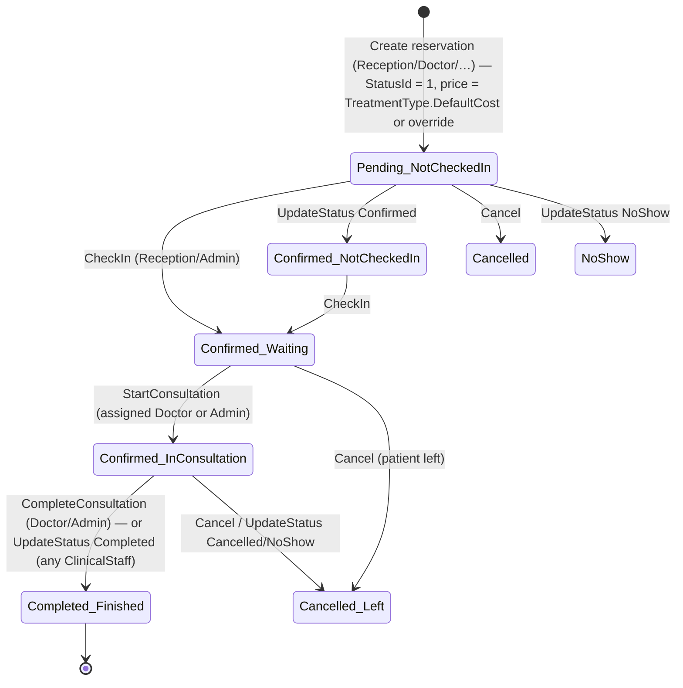

# 04 — Business Capability Map

Phase 2 deliverable. Describes what the application does today, by capability, and where each rule is enforced. Roles are the *effective* server-side roles (see `05-…`). "Verified" = read in code; workflows were not exercised in a browser.

## 1. Capability overview

| # | Capability | Sub-capabilities | Primary roles | Main code |
|---|---|---|---|---|
| C1 | Access & identity | Phone/password sign-in, change password, users, roles, activate/deactivate | All; Admin manages | `AuthController`, `AuthService`, `UsersController`, `UserService`, `RolesController` |
| C2 | Patient registry | Register, search, demographics, medical background, phones, addresses, source attribution, dashboard, timeline | Reception, Doctor, Nutritionist, Admin (medical info and timeline: Doctor/Admin) | `PatientsController`, `PatientService`, `Api/PatientsApiController` |
| C3 | Scheduling | Create/edit reservations, appointment board, list, today, cancel, status change, history report | Reception, Doctor, Nutritionist, Admin | `ReservationsController`, `ReservationService` |
| C4 | Visit flow (queue) | Check-in, doctor queue, start consultation, consultation screen, complete consultation | Reception (check-in), Doctor (consult), Admin | `ReservationsController.{CheckIn, Queue, StartConsultation}`, `MedicalRecordsController.{Consultation, CompleteConsultation}` |
| C5 | Clinical documentation | Medical record, treatments, lock, prescriptions + items + attachments + print, drug autocomplete | Doctor, Admin (lock: Admin) | `MedicalRecordsController`, `PatientRecordService`, `Api/MedicinesController`, `EgyptianDrugService` |
| C6 | Follow-up management | Follow-up date on record, pending follow-up list, book follow-up reservation, dismiss | Doctor, Reception, Admin | `FollowUpsController`, `PatientRecordService.{GetPendingFollowUps, DismissFollowUp}`, `ReservationService.BookFollowUpAsync` |
| C7 | Lab requests | Request one/many analyses, status, results notes, attachments, print request slip | Doctor, Admin | `AnalysisController`, `AnalysisService` |
| C8 | Nutrition programmes | Packages and items, enrollment with discount, weekly follow-ups (measurements, administered items, lab results), enrollment status | Nutritionist, Admin (package & catalogue admin: Admin) | `NutritionController`, `NutritionService` |
| C9 | Billing & collections | Due amount, collect, cancel (write-off), change amount, adjustments audit, patient financial summary, first-visit source/clinic deduction | Reception, ReceptionAdmin, Admin | `PaymentsController`, `PaymentService` |
| C10 | Financial reporting | Payment dashboard (by clinic, by source, unpaid lists), drill-down, date-range report, today's revenue on dashboard | Admin (full); Reception/ReceptionAdmin (unpaid only, today-scoped report); Doctor (own report) | `PaymentsController.{Dashboard, Report, DashboardLineDetails}`, `DashboardController` |
| C11 | Configuration & reference data | Clinics, patient sources, clinic-source agreements, treatment/analysis/injection/vitamin types | Admin | `ClinicsController`, `PatientSourcesController`, `LookupsController`, `NutritionController` (types) |
| C12 | Operations & maintenance | Auto-migrate + seed on start, recalculate paid statuses, backfill zero-cost payments | Admin / system | `Program.cs`, `DbSeeder`, `PaymentsController.{RecalculateAllPaidStatuses, BackfillZeroCostPayments}` |

Not present today: patient self-service portal (role `Patient` exists unused), laboratory department workflow (lab reception/technician/doctor — **deferred to enhancements by decision**), clinic-management reporting beyond payments, notifications (SMS/email), appointment reminders, insurance claims, inventory/stock for injections and vitamins, audit of clinical changes.

## 2. Core workflow: outpatient visit



State = `ReservationStatuses.StatusName` + `Reservations.QueueStatus`. After completion, Admin and Reception users are redirected to *Collect payment* when a balance is due (`MedicalRecordsController.CompleteConsultation`, `ReservationsController.UpdateStatus`). Note that `UpdateStatus` lets any ClinicalStaff user (including Reception and Nutritionist) set *Completed* on an in-consultation reservation, bypassing the doctor-only `CompleteConsultation` action (`ReservationService.cs:806–813`). Transitions are enforced in `ReservationService` with **conditional set-based updates** (`ExecuteUpdateAsync` with the expected current state in the `WHERE`), so a stale screen cannot apply an invalid transition (Verified: `CheckInAsync` lines 551–600, `StartConsultationAsync` 602–640, `UpdateStatusAsync` 755–872, `CancelReservationAsync` 890–978, `CompleteConsultationAsync` 1063–1130). Status changes and completion run inside `sp_getapplock` transactions.

Pricing and payment status:
- Price = `TreatmentType.DefaultCost` unless the form supplies `TotalAmount` (`ReservationService.cs:61`). Any role that can create reservations can override the price.
- Zero-price reservations are marked paid and get a real 0-amount payment row so they appear in reports (`RecordZeroCostPaymentAsync`). This is a second `SaveChanges` after the reservation insert, not in one transaction.
- `Reservations.IsPaid` is recalculated from payments (Active **and** Cancelled count as coverage — a cancelled payment is a write-off, not a refund; `PaymentService.cs:532–536`).
- `POST /Reservations/MarkPaid` sets `IsPaid = true` with **no payment record**; no screen links to it any more (the toggle partial now shows a read-only badge), but any ClinicalStaff user can still post to it.

## 3. Clinical documentation

| Step | Rule | Enforced in |
|---|---|---|
| Consultation opens record | One record per reservation (unique filtered index on `PatientRecords.ReservationId`); creator must be the reservation's doctor unless Admin | `PatientRecordService.CreateRecordAsync` lines 38–150, inside `ExecuteReservationRecordAsync` lock |
| Edit record, add/remove treatments, prescription items | Allowed for any Doctor/Admin while **unlocked** — cross-doctor editing **intended** (owner decision 2026-10-26) | `PatientRecordService` (`!r.IsLocked` in update predicates) |
| Lock record | Admin only; locked records reject edits | `MedicalRecordsController.Lock`, `PatientRecordService.LockRecordAsync` |
| Prescription | Header + free-text items; drug name autocomplete from DwaPrices; print in A4/A5 and design variants; attachments | `MedicalRecordsController.*Prescription*`, `PrintPrescription.cshtml` |
| Follow-up | Record carries `FollowUpDate` / `FollowUpStatus` (Pending → Booked / Dismissed); `FollowUps/Index` lists due items; booking creates a linked reservation under a lock | `FollowUpsController`, `PatientRecordService.GetPendingFollowUpsAsync`, `ReservationService.BookFollowUpAsync` |

## 4. Lab requests

`MedicalAnalyses.Status`: Requested → InProgress → Completed / Cancelled (`AnalysisStatus` enum). `AnalysisService.UpdateStatusAsync` assigns any status without checking the current one (line 272); the controller discards the result. Requests can be batch-created for a patient and printed as a slip. Results are free-text notes plus file attachments. Lab-department roles are not modelled (deferred).

## 5. Nutrition programme

```
Package (weeks, sessions/week, base price, max discount, planned items per week)
   └─ Enrollment (patient, nutritionist, start/end, discount ≤ max, Status: Active/OnHold/Completed/Cancelled, TotalPaid)
        └─ WeeklyFollowUp (week n: weight, height, BMI [computed], body composition, BP, compliance, notes, IsCompleted)
              ├─ AdministeredItems (actual quantities of planned injections/vitamins)
              └─ LabResults (per analysis type)
```

- Enrollment payments are collected through `Payments` with `EnrollmentId`; `TotalPaid` on the enrollment is updated in `PaymentService` (collect, change amount; not reversed on cancel).
- Nutrition "Follow-up" visits are booked as zero-cost reservations (treatment type seeded at 0.00).
- Enrollment status can be set to any value from any value (`NutritionService.UpdateEnrollmentStatusAsync`, line 271).

## 6. Billing and source attribution

| Rule | Detail | Where |
|---|---|---|
| One target per payment | Exactly one of reservation or enrollment | `PaymentService.CollectPaymentAsync` line 22 |
| Serialisation | One payment operation per patient at a time (`sp_getapplock` on `PatientPayment:{id}`, 10 s timeout) | `UnitOfWork.ExecutePatientPaymentAsync` |
| Amount | Must be > 0 except to log a genuinely zero-cost reservation | lines 99–116 |
| First-visit deduction | If the patient has no active payment yet and has an active source: percentage = clinic-source agreement (if active) else source default; `SourceDeductionAmount` and `ClinicNetAmount` snapshotted on the payment | lines 118–150 |
| Cancel | Status → Cancelled with reason; excluded from revenue; still counts as coverage | lines 500–550 |
| Change amount | Records a `PaymentAdjustment`, re-derives the split with the original percentage, adjusts enrollment `TotalPaid` | lines 553–636 |
| Audit view | Per-payment history from adjustments + cancellation fields | `GetPaymentAuditAsync`, `Payments/Audit.cshtml` |
| Report scoping | Reception/ReceptionAdmin forced to today (Cairo) and unpaid views; Doctors see own; Admin all | `PaymentsController.Report`, verified by `PaymentAccessChecks` (30 checks) |

## 7. Capability × role matrix (server-enforced)

✓ = full, R = read/limited, — = none. Derived from effective route roles.

| Capability | Admin | Doctor | Nutritionist | Reception | ReceptionAdmin* |
|---|---|---|---|---|---|
| C1 manage users/roles | ✓ | — | — | — | — |
| C2 patients (basic) | ✓ | ✓ | ✓ | ✓ | — |
| C2 medical info, timeline | ✓ | ✓ | — | — | — |
| C3 reservations, board | ✓ | ✓ | ✓ | ✓ | — |
| C4 check-in | ✓ | — | — | ✓ | — |
| C4 queue view | ✓ (all) | ✓ (own) | — | ✓ (all) | — |
| C4 start/complete consultation | ✓ | ✓ | — | — | — |
| C5 medical records, prescriptions | ✓ | ✓ | — | — | — |
| C6 follow-ups | ✓ | ✓ | — | ✓ | — |
| C7 lab requests | ✓ | ✓ | — | — | — |
| C8 nutrition enrollments/follow-ups | ✓ | — | ✓ | — | — |
| C8 packages, injection/vitamin types | ✓ | — | — | — | — |
| C9 collect/cancel/change payments | ✓ | — | — | ✓ | ✓ |
| C10 payment dashboard | ✓ (full) | — | — | R (unpaid) | R (unpaid) |
| C10 payment report | ✓ | R (own) | — | R (today) | R (today) |
| C11 configuration | ✓ | — | — | — | — |
| C12 maintenance jobs | ✓ | — | — | — | — |

\* `ReceptionAdmin` exists only in policies and in the database (created through the Roles screen, not seeded); a user holding only this role can reach payments but not patients or reservations.

Gaps against the stated user groups: **Clinic Management** has no read-only management role (only Admin sees full financials); **Lab Doctor / Lab Tech / Lab Reception** have no role or screens — deferred to the enhancements phase.
