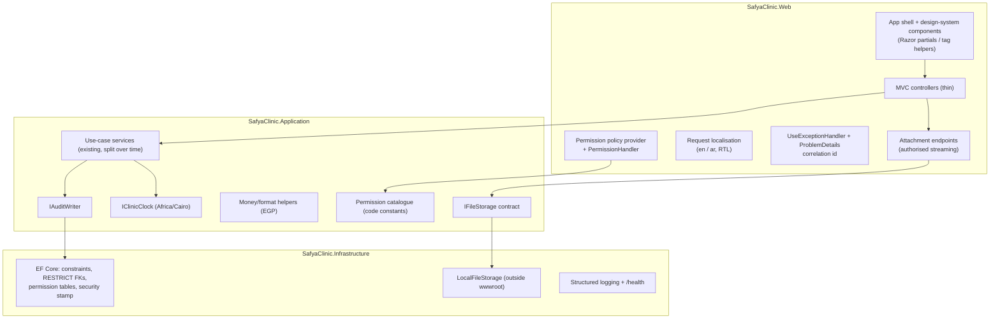
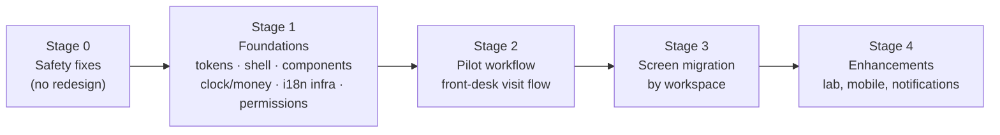

# 11 — Target-State Proposal (Phase 4: Propose)

Status: **proposal for review**, 2026-10-27. Nothing here is implemented or approved yet. Section 12 lists the decisions needed from the owner before Phase 5 (Prioritize).

Inputs: findings F01–F32 (`10-…`), owner decisions (`09-…` §4), enhancement backlog E1–E8 (`09-…` §5), and the existing UI/UX guides in `SafyaClinic/docs/` (layout shell, skip link, page-header and filter styles already introduced).

## 1. Constraints that shape the proposal

| # | Constraint | Source | Consequence |
|---|---|---|---|
| K1 | Server-rendered ASP.NET Core 8 MVC, 85 Razor views, Bootstrap 5.3 from CDN, no JS build step | Verified (`01-…` §9) | Prefer evolving the current stack over a rewrite |
| K2 | Shared Windows hosting (MonsterASP) for test and demo; manual Web Deploy | `02-…` | Avoid components that need long-lived server connections at scale or extra services |
| K3 | One developer implements every step; Claude plans and reviews | Working agreement | Steps must be small, independently testable and reversible |
| K4 | Preserve business behaviour unless a change is approved | Rule 10 | Behaviour changes (F05, F10, F11, F12) are listed explicitly as decisions |
| K5 | English default UI, Arabic switchable (labels only); notes in either language | Decision 2026-10-27 | Localisation and RTL must be designed in, not added per page |
| K6 | Sensitive actions governed by admin-managed permission groups | Decision 2026-10-27 | Authorization model change is required |
| K7 | Future patient mobile app and doctor notifications | E4–E6 | Leave room for an API and notifications; do not build them now |
| K8 | Dev/test data only today | Decision 2026-10-26 | Schema changes are low-risk now and get riskier later — do the structural ones early |

## 2. Target architecture (changes only where justified)

The four-project layout stays. Changes are additive services and a few cross-cutting mechanisms.



| # | Change | Fixes | Notes |
|---|---|---|---|
| A1 | **Permission-based authorization with admin-managed groups** (§3) | F05, F06, F32, K6 | Central change; everything else can proceed in parallel |
| A2 | **Password and session hardening** on the existing custom auth: `PasswordHasher<User>` with rehash on login, lockout columns, password policy, security-stamp validation in `OnValidatePrincipal`, admin password reset, self/last-admin guards | F03, F04 | Option of full ASP.NET Core Identity discussed in §3.5 |
| A3 | **`IFileStorage`**: files outside `wwwroot`, allow-list + size limit, authorised streaming with `nosniff`, transactional save, soft delete | F01, F17 | Migration step moves existing files and rewrites stored paths |
| A4 | **Clinic context services**: `IClinicClock` (clinic time zone for "today" and display), money formatting in EGP, enum display names | F13, F14, F28 | Small, high leverage; needed by every redesigned screen |
| A5 | **Error handling and observability**: built-in exception handler with generic message + correlation id, structured logs, `/health`, audit events written to the existing `AuditLogs` table | F08, F15, F23 | `AuditLogs` columns get typed lengths |
| A6 | **Data integrity migration**: unique normalised primary phone, slot-overlap rule in service, RESTRICT on financial/clinical FKs, drop shadow FKs, fix defaults, attachment content-type length | F11, F17, F20 | Tested on a DB copy; one migration per concern |
| A7 | **Workflow rules in services**: lab analysis Requested → Completed only with a result file; enrollment transition table; single source of payment coverage; doctor-scoped status changes | F10, F12, F32 | Behaviour changes — need sign-off (§12) |
| A8 | **Delivery hygiene**: secrets out of git, migrations as a deploy step, remove legacy cookie package, test project + CI, SDK pin | F02, F07, F19, F22 | |
| A9 | **Reserved for later (E4–E6)**: versioned `/api/v1` with a separate bearer scheme for mobile, `Notifications` table + in-app bell, push later | — | Design only when the mobile enhancement is scheduled |

Explicitly **not** proposed: microservices, CQRS/MediatR as a mandate, replacing EF, rewriting the UI in a SPA, a big-bang redesign.

## 3. Permission-group model (A1)

### 3.1 Concepts

| Concept | Who defines it | Example |
|---|---|---|
| **Permission** | Developers, in code (constants), seeded to the DB | `Reservations.OverridePrice`, `Payments.MarkPaidWithoutPayment`, `Consultations.CompleteOnBehalf` |
| **Permission group** | Admin, in the UI | "Front desk", "Senior reception", "Doctors", "Billing supervisors" |
| **User ↔ group** | Admin, in the UI | A user can belong to several groups; effective permissions = union |
| **Clinician type** | Admin, on the user | None / Doctor / Nutritionist (later Lab doctor). Drives *who appears in doctor pickers and queues*, replacing role IDs 2 and 5 |

Admins can create, rename and delete groups and toggle permissions, but cannot invent permissions — code can only enforce permissions it knows about, which avoids the "Reception Admin grants nothing" failure (F06).

### 3.2 Data model

```
Permissions        (Code PK nvarchar(100), Area, DisplayKey, IsSensitive)
PermissionGroups   (Id, Name unique, Description, IsSystem, CreatedAt/By, UpdatedAt/By)
GroupPermissions   (GroupId FK, PermissionCode FK)  PK(GroupId, PermissionCode)
UserGroups         (UserId FK, GroupId FK, AssignedAt/By)  PK(UserId, GroupId)
Users              + ClinicianType nvarchar(20), SecurityStamp nvarchar(64),
                     AccessFailedCount int, LockoutEndUtc datetime2?, MustChangePassword bit
```

### 3.3 Enforcement

- Controllers: `[RequirePermission(Permissions.Reservations.OverridePrice)]` → a custom `IAuthorizationPolicyProvider` creates `perm:<code>` policies on demand; one `PermissionHandler` checks the user's effective set.
- Effective permissions are loaded once per request from a small cache keyed by user id + security stamp; changing a group, membership or user bumps the stamp, so changes apply on the next request (also fixes F04).
- Services receive an `ICurrentUser` with `Has(permission)` for rules that depend on data (e.g. "change status of another doctor's visit").
- Views: a `User.Can(...)` helper and a `<permission>` tag helper replace the 58 `IsInRole("…")` checks; the sidebar is built from the same catalogue.
- Every use of an `IsSensitive` permission writes an audit event.

### 3.4 Initial catalogue and migration

Seed system groups that reproduce **today's effective access exactly** (from `05-…`), so the switch-over changes no behaviour; then the Admin adjusts.

| Area | Permissions (initial) |
|---|---|
| Patients | `View`, `Create`, `EditBasic`, `EditMedical`, `ViewTimeline` |
| Reservations | `View`, `Create`, `Edit`, `Cancel`, `CheckIn`, `ChangeStatus`, `ChangeStatusForOtherDoctors`, `OverridePrice`, `CompleteOnBehalf` |
| Queue | `ViewOwn`, `ViewAll` |
| Consultations / Records | `Start`, `Complete`, `EditRecord`, `LockRecord`, `Prescribe` |
| Lab | `Request`, `UploadResult`, `Complete`, `DeleteAttachment` |
| Nutrition | `ManageEnrollments`, `RecordFollowUps`, `ManagePackages` |
| Payments | `Collect`, `Cancel`, `ChangeAmount`, `MarkPaidWithoutPayment`, `ViewDashboard`, `ViewReportAll`, `ViewReportOwn`, `ViewReportToday`, `RunMaintenance` |
| Settings | `ManageUsers`, `ManageGroups`, `ManageCatalogues`, `ManageClinics`, `ManageSources` |

Sequence: (1) add tables and seed groups mirroring roles, copy `UserRoles` → `UserGroups`; (2) switch policies one controller at a time to permissions, verified by an automated access-matrix test (extending `PaymentAccessChecks`); (3) replace view role checks; (4) remove `Roles`/`UserRoles` after a release with no regressions.

### 3.5 Alternatives considered

| Option | For | Against | Verdict |
|---|---|---|---|
| **A. Permission groups on the existing custom auth (proposed)** | Exactly matches the owner's requirement; small, incremental; no schema upheaval of `Users` | We own password/lockout code (mitigated by using `PasswordHasher<T>`) | **Recommended** |
| B. Adopt full ASP.NET Core Identity (roles + role claims as permissions) | Battle-tested lockout, stamps, 2FA, reset tokens | Large migration of `Users` and login; Identity's roles ≠ the requested groups UI anyway; more moving parts for one developer | Reconsider if 2FA or external login becomes a requirement |
| C. Keep roles, add more fixed roles | Least work | Does not meet the decision; new roles still need code changes | Rejected |
| D. External policy engine / IdP (Entra, Keycloak) | Enterprise features | Heavy for one clinic on shared hosting | Rejected for now |

## 4. Frontend approach

Existing stack verified (K1). Options:

| Option | Description | Benefits | Costs / risks | Fit |
|---|---|---|---|---|
| **F-A. Evolve Razor MVC + Bootstrap 5.3 with a design-system layer (proposed)** | Tokens over Bootstrap's CSS variables, shared Razor components, small vanilla-JS modules; optional **htmx** only where partial refresh clearly helps (queue/board auto-refresh, inline filters) | Reuses all 85 views and the current skill set; screens migrate one at a time; works on shared hosting; RTL via Bootstrap's RTL build | Rich client interactions stay modest; discipline needed to stop page-specific CSS | **Recommended** |
| F-B. Blazor (Server or Web App interactive) | C# components, rich interactivity | Effective rewrite of screens; Server mode needs persistent SignalR circuits (sensitive on shared hosting, per-user memory); two UI models during transition | Not now |
| F-C. SPA (React/Angular/Vue) + API | Best for very interactive UIs; API reusable by mobile | Full rewrite, node toolchain, API for every screen, auth rework; months before parity | Not justified |

**CSS build:** start with **plain CSS custom properties** (no build step) layered over Bootstrap's `--bs-*` variables, assets served locally via LibMan (fixes F30). Move to a Sass build of Bootstrap only if token needs exceed what CSS variables can override (e.g. changing breakpoints or generating utilities).

**Mobile (E4–E6, later):** options to compare when that enhancement is scheduled — (1) installable PWA built on the same app (cheapest; camera/file upload works; push on Android, limited on older iOS), (2) .NET MAUI (C# reuse, native push, app-store overhead), (3) Flutter. The API surface in A9 is the same for all three.

## 5. Application shell and navigation

```
┌──────────────────────────────────────────────────────────────────────────────┐
│ ☰  Safya Clinic   [🔎 Find patient by phone or name…]      🔔  EN|ع  ▾ User │  top bar (56 px)
├──────────────┬───────────────────────────────────────────────────────────────┤
│ Today        │ Breadcrumb: Front desk › Reservations › #41                   │
│ FRONT DESK   │ ┌───────────────────────────────────────────────────────────┐ │
│  Patients    │ │ PATIENT HEADER (clinical & patient pages)                 │ │
│  Appointments│ │ Name · 36 F · ☎ primary · ⚠ Allergies: Penicillin        │ │
│  Check-in    │ │ Chronic: DM2 · Last visit 12 Oct · Balance due 200 EGP    │ │
│  Follow-ups  │ └───────────────────────────────────────────────────────────┘ │
│ CLINICAL     │ Page header: H1 title · status badge · primary action · ⋯    │
│  My queue    │                                                               │
│  Lab requests│ Content (cards, tables, forms from the component library)    │
│ NUTRITION    │                                                               │
│ BILLING      │                                                               │
│ SETTINGS     │ Toast region (polite) · Confirm dialog (shared)              │
└──────────────┴───────────────────────────────────────────────────────────────┘
```

| Element | Behaviour |
|---|---|
| Top bar | Global patient search (phone first — the agreed unique identifier), notifications bell (placeholder until E5), language switch, user menu (profile, change password, sign out) |
| Sidebar | Grouped by **workspace**, items shown by permission; collapsible to icons ≥ lg; off-canvas below lg (already exists); current item `aria-current="page"` |
| Patient header | Shown on every patient-scoped and clinical page; allergies always visible and highlighted (fixes F09); collapses to one line on phones |
| Page header | One `h1` per page (fixes 18 screens), status, one primary action, overflow menu for secondary actions |
| Feedback | Toasts for success, inline alerts for errors, field-level validation, no empty red boxes (F26), shared confirm dialog replacing `confirm()` |
| Print | Separate print layout for prescription, lab slip and reports sharing the same tokens |

## 6. Information architecture

Organise by **workspace** (what the person is doing), not by database table.

| Workspace | Screens (target) | Today's equivalents |
|---|---|---|
| **Today** (home) | Role-aware dashboard: my tasks, today's appointments, waiting patients, unpaid visits, KPIs allowed by permission | `Dashboard/Index` |
| **Front desk** | Patients (search, register), Appointments (board ⇄ list toggle, one screen), Check-in desk, Follow-ups to book | `Patients/*`, `Reservations/Index`, `Board`, `Today`, `Queue` (reception view), `FollowUps/*` |
| **Patient workspace** | Tabs: Overview · Visits · Records · Lab · Nutrition · Payments · Timeline | `Patients/Details`, `Timeline`, `MedicalRecords/PatientRecords`, `Analysis/PatientAnalyses`, `Nutrition/PatientEnrollments`, `Payments/PatientSummary` |
| **Clinical** | My queue, Consultation workspace (record + prescriptions + lab orders on one screen with patient header), Lab requests list | `Reservations/Queue`, `MedicalRecords/*`, `Analysis/*` |
| **Nutrition** | Enrollments, weekly follow-up, packages | `Nutrition/*` |
| **Billing** | Collections (unpaid), Payments report, Financial dashboard, Payment audit | `Payments/*` |
| **Settings** | Users, Permission groups, Clinics & agreements, Patient sources, Catalogues (treatment, analysis, injection, vitamin types), Clinic profile (name, address, phone for printouts), Language defaults | `Users`, `Roles`, `Clinics`, `PatientSources`, `Lookups/*`, `Nutrition/*Types` (duplicates removed), `ClinicInfo` config |
| **Account** | Profile, language, change password | `Auth/ChangePassword` |

Consolidations: one appointments screen instead of List + Board + Today; one catalogue editor pattern instead of two injection/vitamin screens; patient-scoped lists become tabs instead of separate pages; `Reservations/Index-old` removed.

## 7. Design-system foundation

Detailed tokens and component specs are Phase 6; this section fixes the structure.

**CSS layers (load order):** `tokens.css` (primitive + semantic custom properties, light theme, RTL-neutral) → `bootstrap-bridge.css` (maps tokens onto `--bs-*`) → `components.css` (shell and component classes, `app-` prefix as already started) → `utilities.css` (layout helpers not in Bootstrap) → page CSS only for genuinely unique cases (reviewed).

**Token groups:** colour (primitive scale + semantic: surface, text, border, primary, success, warning, danger, info, and **status** tokens for reservation/payment/lab states), typography, spacing, radius, shadow, motion (with reduced-motion overrides), breakpoints, layout (header height, sidebar width, page gutter, content max width), table/grid lines, focus ring.

**Rule from the brief, enforced in review:** every recurring value comes from a token, component or layout utility; inline `style=""` and hex values in views are not accepted in migrated screens.

**Component delivery in Razor — options:**

| Mechanism | Best for | Trade-off |
|---|---|---|
| Partial views (`_PageHeader`, `_EmptyState`) | Markup-heavy, simple data | Weak typing of parameters unless each has a small model |
| **Tag helpers** (`<app-badge status="…">`, `<app-field asp-for="…">`) | Small, frequently used elements; enforce accessibility attributes | C# to maintain; very readable in views |
| View components | Elements that load their own data (patient header, notifications) | Hidden queries — keep them few and cached |

Proposed: tag helpers for primitives (button, icon-button with required label, badge, field, money, datetime), partials for layout blocks, view components for the patient header and sidebar.

**Initial component inventory:** app shell, page header, breadcrumb, patient header, card, KPI tile, data table (sortable header, empty state, responsive stacked mode, pagination), filter bar, form field (label, hint, error, required marker), select, date/time inputs, money display, date-time display (clinic time zone), status badge (semantic), alert, toast, confirm dialog, modal, tabs, dropdown/overflow menu, attachment list with preview, timeline item.

## 8. Accessibility approach

- **Target:** WCAG 2.1 AA for all migrated screens.
- **By construction:** contrast-checked tokens (text ≥ 4.5:1, large text/UI ≥ 3:1), status shown by text + icon not colour alone, components that cannot render without a label/name, one `h1` and ordered headings from the shell, real lists, focusable scroll regions, visible focus ring token, `prefers-reduced-motion` honoured.
- **Verification:** axe-core run by Playwright in CI on every migrated screen (zero serious/critical), keyboard walk-through per pilot flow, one screen-reader pass (NVDA) per workspace, RTL check.
- **Content:** plain-language labels and error messages, all strings localisable.

## 9. Responsive behaviour

| Context (assumed — U5 still open) | Width | Priority screens | Pattern |
|---|---|---|---|
| Reception desktop | 1366–1920 | Appointments, check-in, collections | Dense tables, side panels |
| Consultation room laptop/tablet | 768–1366 | Queue, consultation workspace | Two-column workspace collapsing to one; sticky patient header |
| Phone (doctor glance, owner) | 360–430 | Today, my queue, patient overview | Stacked cards for lists; primary action reachable; 44 px touch targets |

Bootstrap breakpoints kept (sm 576, md 768, lg 992, xl 1200, xxl 1400). Data tables switch to stacked cards below `md` for the listed priority screens; secondary tables keep horizontal scroll with a visible scroll hint.

## 10. Localisation and RTL

- `AddLocalization` + `UseRequestLocalization` with cultures `en` (default) and `ar`; the user's choice stored on the user record and in a cookie; language switch in the top bar.
- `.resx` resources per area for labels, messages and **enum display names** (fixes raw "InternalMedicine", "APositive").
- Layout: `<html lang dir>` from the culture; Bootstrap RTL stylesheet when `ar`; component CSS written with logical properties (`margin-inline-start`, `inset-inline-end`); icons that imply direction mirrored.
- Data rule (decision): structured data in English; notes/comments accept either language and render with `dir="auto"`.
- Numbers, dates and money: formatted by the clinic clock/money helpers; Western digits by default (confirm in §12).
- Print documents follow the selected language.

## 11. Incremental migration strategy



| Stage | Content | Exit criteria |
|---|---|---|
| 0 Safety | F01 uploads, F02 secrets, F03/F04 auth hardening, F07 package, F08 errors, interim restriction of F05 actions to Admin | No Critical findings open; auth/access tests pass |
| 1 Foundations | Tokens + bridge, local assets, shell (top bar, sidebar from catalogue, page header, toasts, confirm dialog), patient header, clinic clock + money, localisation plumbing (English only first), permission tables + policy provider (mirroring today), test project + CI with axe | Existing screens still work inside the new shell; access matrix unchanged |
| 2 Pilot | **Front-desk visit flow**: find/register patient → book (one appointments screen) → check in → doctor queue → consultation workspace with patient header and allergies → complete → collect payment. Includes F09, F11, F12, F32, the permission-gated actions of F05, write-off payments (D5) and **doctor availability calendars with slot booking (D7, §15)** | §13 metrics met on the pilot; owner acceptance |
| 3 Migration | Workspaces in order: Patient workspace → Billing → Clinical (records, prescriptions; lab screens restyled only, rules unchanged per D9) → Nutrition → Settings → print documents. Each screen meets the *screen done* definition below. Arabic resources added per workspace | All screens migrated; legacy CSS removed |
| 4 Enhancements | E1 lab services, E2 management role, E3 demo access, E4–E6 mobile + notifications, E8 Arabic completion | Separately scoped |

**Screen "done" definition:** uses shell + components only (no inline styles, no hex values) · one `h1` · axe zero serious/critical · keyboard path checked · strings localised · works at 375/768/1366 · permissions via catalogue · server-side validation messages visible · automated smoke test.

**Coexistence:** old and new screens share the same layout and tokens, so there is no visual "two apps" period; old Bootstrap classes keep working because tokens feed Bootstrap's variables.

## 12. Owner decisions (2026-10-27)

| # | Decision | Outcome |
|---|---|---|
| D1 | Authorization model | **Accepted:** permission groups on the existing auth (§3) |
| D2 | Frontend approach | **Accepted:** evolve Razor + Bootstrap with a design-system layer (§4) |
| D3 | Pilot workflow | **Accepted:** front-desk visit flow (§11) |
| D4 | Interim restriction (Stage 0) | **Accepted:** price override and *Completed*-by-status limited to Admin until permission groups ship |
| D5 | Mark paid without payment | **Remove `MarkPaid` entirely.** Uncollected amounts are settled by a **zero-amount payment or a write-off payment**, recorded and audited. New permission `Payments.WriteOff`, granted to the **Reception Admin** and **Clinic Admin** groups |
| D6 | Status changes on another doctor's work | **Medical records:** any doctor may change/edit another doctor's unlocked record (consistent with 2026-10-26). **Reservations:** a doctor may **never** change the status of another doctor's reservation — enforced as a service rule for any user with a clinician type, not only as a grantable permission. Front-desk and admin groups keep `Reservations.ChangeStatus` |
| D7 | Scheduling | **No double booking.** Booking calendar shows only the current and future dates/times, and only free slots. Each doctor has a **calendar mode**: *Open* (bookable all day within clinic hours) or *Specific slots* (doctor selects one or more time slots per day; bookings only into those slots). This is a new capability — see §15 |
| D8 | Duplicate patients | **Primary phone is unique; no duplicates.** No production data, so existing duplicates in dev/test data can be cleaned directly (no merge tool) |
| D9 | Lab analyses | **Leave the lab module as it is** until the lab revamp (E1). F10 moves to the enhancement phase |
| D10 | Digits | **Western digits (0–9) everywhere**, both languages |
| D11 | Screen sizes | **Accepted recommendation:** design and test at 1366 × 768 (reception/admin), 1024 × 768 (consultation), 390 × 844 (phone) (§16) |
| D12 | Brand and layout | **Direction A — Violet & Teal (logo colours) with a light labelled sidebar**, borrowing **Direction C's plainer tables** (neutral borders, light header, outlined status pills). Canvas: *Safya Clinic — Brand & Layout Options* (§16) |

## 13. Measurable success criteria

| Area | Metric | Baseline (2026-10-27) | Target |
|---|---|---|---|
| Security | Open Critical / High security findings (F01–F08) | 2 / 6 | 0 / 0 after Stage 0–1 |
| Access | Role-name strings outside the permission catalogue | 58 view checks + 7 policies + inline roles | 0 |
| Accessibility | axe serious + critical violations on migrated screens | 37/37 screens fail colour-contrast; 261 serious/critical nodes in total | 0 per screen |
| Accessibility | Screens without one `h1` | 18 of 37 | 0 |
| Design system | Inline `style=""` / hex colours in migrated views | 59 / ≈30 across views | 0 |
| i18n | UI strings in resources | 0 % | 100 % English by end of Stage 3; Arabic per workspace |
| Correctness | Visits completed without a medical record; reservations "Covered" with a balance due | possible (reproduced) | impossible (tests) |
| Data | Duplicate primary phones; overlapping doctor slots accepted | possible (reproduced) | blocked by DB/service + tests |
| Quality | Automated tests in solution / CI | 0 / none | service tests for reservations, payments, lab, permissions; Playwright pilot flow + axe in CI |
| Performance | Payment dashboard response with 50k reservations | not measured | p95 < 1 s (measure before/after F21) |
| Workflow | Clicks from "patient arrives" to "checked in" for an existing patient; time to book a reservation | measure at pilot start | −30 % clicks; book in < 60 s for a known patient (usability check with 2–3 staff) |
| Operations | Startup auto-migration in non-dev environments | yes | no; scripted, reviewed deploy |

## 14. Traceability: Critical and High findings → proposal

| Finding | Addressed by |
|---|---|
| F01 public uploads | A3, Stage 0 |
| F02 committed credentials | A8, Stage 0 |
| F03 passwords / lockout | A2, Stage 0 |
| F04 live sessions after deactivation | A2 security stamp, A1 §3.3 |
| F05 workflow bypass | D4 interim, A1 permissions, D5, Stage 2 |
| F06 hard-coded roles | A1 |
| F07 vulnerable packages | A8, Stage 0 |
| F08 raw errors | A5, Stage 0 |
| F09 allergies not visible | Patient header (§5), Stage 1–2 |
| F10 lab lifecycle | Deferred to lab revamp (E1) by D9 |
| F11 duplicates / double booking | A6, D7, D8, Stage 2 |
| F12 coverage contradictions | A7, Stage 2 |
| F25 accessibility | §7–§8, screen-done definition |

Medium/Low findings map to A4–A8, §6–§10 and Stage 3; full mapping will be in the Phase 5 roadmap.

## 15. New capability from D7: doctor availability and slot booking

| Item | Proposal |
|---|---|
| Doctor calendar mode | Per doctor (and per clinic if a doctor works in several): `Open` or `SpecificSlots` |
| Open mode | Bookable between the clinic's opening hours; slot length = treatment type duration (default 30 min) or a doctor default |
| Specific-slots mode | Doctor (or delegated front desk) defines availability per date: one or more time ranges or single slots; optional weekly template copied forward |
| Booking rules | Only current/future slots; a slot is offered only if free; server enforces no overlap for the doctor (and optionally the room) inside the existing reservation lock; past dates disabled in the date picker and rejected server-side |
| Data (sketch) | `DoctorSchedules` (DoctorId, ClinicId, Mode, DefaultSlotMinutes), `DoctorAvailability` (DoctorId, ClinicId, Date, StartTime, EndTime), optional `ClinicOpeningHours`; reservations keep date + time + duration |
| UI | Appointments screen: day/week view per doctor with free slots clickable; reception books in two clicks for a known patient |
| Permissions | `Schedule.ManageOwn` (doctors), `Schedule.ManageAll` (front desk admin), `Reservations.Create` |
| Clinic hours | **Each clinic sets its opening hours** (per weekday); open-mode slots are generated only inside them |
| Breaks | **Doctors define break times** inside an open calendar; no slots offered during breaks |
| Removing booked slots | Removing or shrinking availability that already has bookings **must prompt a reschedule** of each affected reservation before the change is saved |
| Multiple clinics | A doctor **may work in several clinics on the same day, in non-overlapping time ranges**; the overlap check spans all clinics for that doctor |

## 16. Screen sizes and brand — recommendation (D11, D12)

**Screen sizes.** Design and test at three reference widths, matching Bootstrap breakpoints so no custom grid is needed:

| Reference | Size | Represents | Design priority |
|---|---|---|---|
| Desktop | **1366 × 768** (also checked at 1920 × 1080) | Reception and admin PCs — the most common office resolution | Primary for front desk, billing, settings |
| Tablet / small laptop | **1024 × 768** (portrait 768 × 1024 checked) | Consultation room, nutrition follow-ups | Primary for queue and consultation workspace |
| Phone | **390 × 844** (360 × 800 checked) | Doctors and owner checking today's queue and patients | Read-mostly: today, my queue, patient overview |

**Brand (chosen 2026-10-27): Direction A with C's tables.**

| Token role | Value | Contrast |
|---|---|---|
| Primary (buttons, links, selection) | `#5B21B6` violet | 8.98:1 on white |
| Primary subtle (selected nav, in-consultation) | `#EDE9FE` | violet text 7.57:1 |
| Accent teal (secondary actions, info) | `#0E7490` | 5.36:1 on white |
| Text / muted text | `#1C1530` / `#5B5670` | muted 6.49:1 on page |
| Page / surface / border | `#F7F6FB` / `#FFFFFF` / `#E4E1EE` | — |
| Status tokens | Booked `#92400E`/`#FEF3C7`, Waiting `#155E75`/`#CFFAFE`, In consultation `#5B21B6`/`#EDE9FE`, Completed `#166534`/`#DCFCE7`, Cancelled/Allergy `#991B1B`/`#FEE2E2` | all ≥ 6.3:1 |
| Type | Inter (English), IBM Plex Sans Arabic (Arabic), Western digits, tabular numbers for money/time | — |

Tables follow C: white surface, light header row, 1 px neutral row dividers, outlined status pills, no zebra fills. Final token set, component specs and states are Phase 6.
