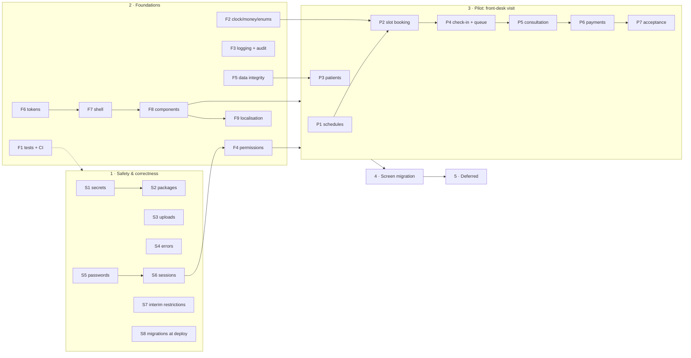

# 12 — Prioritised Roadmap (Phase 5: Prioritize)

Status: **proposal for review**, 2026-10-27. Builds on findings `10-…` (F01–F32), the target state and decisions in `11-…` (D1–D12, §15 scheduling, §16 brand), and the backlog in `09-…` §5.

## How to read this

- **Groups** follow the brief: immediate safety and correctness → short-term foundations → pilot workflow → incremental screen migration → deferred opportunities.
- **Every item becomes one or more Phase 7 slices.** For each slice I give the plan, affected files, risks, tests, rollback and acceptance criteria; you implement on a feature branch; I review.
- **Value:** High / Medium / Low, with the reason. **Risk:** implementation and regression risk.
- **Effort bands** (no time estimates — there is no velocity data yet). A *step* is one reviewable change of the kind used in the existing UI/UX guides.

| Band | Meaning |
|---|---|
| XS | 1 step, ≤ 3 files, no migration |
| S | 2–3 steps in one area; at most a small migration |
| M | 4–6 steps, or one migration that handles existing data |
| L | 7–12 steps or a new feature; delivered as 2–4 slices |
| XL | > 12 steps; must be split before starting |

After the first 3–4 slices we will have a measured pace and can turn bands into a calendar if you want one.

## Sequence at a glance

**Recommended first slices, in order:** F1 (test project + CI skeleton, so every later slice adds tests) → S1 → S2 → S4 → S3 → S5 → S6 → S7 → S8. Group 1 can be finished before any visual work starts.

---

## Group 1 — Immediate safety and correctness

| ID | Item | Fixes | Value | Risk | Depends on | Effort | Acceptance criteria |
|---|---|---|---|---|---|---|---|
| **S1** | **Remove and rotate committed secrets.** Owner rotates the Web Deploy password in the host panel; delete `safyaclinic.runasp.net-WebDeploy.publishSettings` and `SafyaClinicPublish/` from git; add `*.publishSettings`, `SafyaClinicPublish/` to `.gitignore`; move `Jwt:*` out of committed config; seeder reads the bootstrap admin password from configuration (demo config keeps the published demo password by decision) | F02, F31 (part) | High — anyone with repo access can deploy | Low — deployment needs the new password; nothing in code changes behaviour | — | XS | No credential values in tracked files (`git grep` for `userPWD`, `Jwt`, seeded password returns nothing); publish to test site works with the rotated password; fresh DB still seeds an admin from config |
| **S2** | **Remove vulnerable/unused packages.** Drop `Microsoft.AspNetCore.Authentication.Cookies` 2.3.11, unused JWT packages and the unused JWT generator; drop unused FluentValidation (or keep for F-items if you prefer) | F07, A7 | High — 13 High advisories | Low — cookie auth is in the framework | S1 (JWT config removed together) | XS | `dotnet list package --vulnerable --include-transitive` clean; sign-in/sign-out and all role checks behave as before (PaymentAccessChecks 30/30) |
| **S3** | **Secure attachment storage.** `IFileStorage` with storage outside `wwwroot`; allow-list (PDF, JPEG, PNG; DOCX optional), size limit from `FileStorage:MaxFileSizeBytes`; authorised streaming with `nosniff` and attachment disposition except images/PDF; transactional save/delete; one-off move of existing files and stored paths; remove the committed upload | F01, F17 | **High — Critical finding** | Medium — file moves on test/demo servers; paths stored in DB | — (tests from F1 if available) | M | Anonymous `GET /uploads/...` → 404; authorised user can view/download existing and new attachments; disallowed type/oversize rejected with a message; HTML/SVG never served inline; failed DB insert leaves no file; delete removes or soft-deletes file; existing attachments still open after migration |
| **S4** | **Safe error handling.** `UseExceptionHandler` + ProblemDetails, generic message with correlation id, HTTP 500, full exception logged; remove session-stored message; remove `ex.Message` from Lookups TempData; correct lookup in-use checks (F33). Lookup length validation moves to M5 | F08, F16 (part), F33 | High — information leak, misleading errors | Low | — | S | The 145-char lookup repro shows the generic page (validation itself in M5); a forced exception shows a generic page with a reference id, status 500, logged with the same id; second visit to the error page shows no stale message |
| **S5** | **Password storage and policy.** `PasswordHasher<User>` with transparent rehash on login; min length 10 + confirm field; lockout after 5 failures for 15 min (configurable); failed attempts logged; Admin "reset password" forcing change at next sign-in | F03 | High | Medium — every account's hash migrates on next login; lockout must not lock the only Admin permanently | S1 (seeder) | M | Existing users sign in and their hash is upgraded; new weak password rejected; 5 wrong attempts lock the account, correct password works after lockout ends; reset forces change; unit tests for hash/verify/rehash |
| **S6** | **Session revocation and admin guards.** `SecurityStamp` on users, validated in `OnValidatePrincipal` (short interval); stamp changes on deactivate, role change, password change; block self-deactivation and removing the last Admin | F04, A3 | High | Low–Medium — too-frequent validation adds DB reads (cache by interval) | S5 (same migration) | S | Deactivated user's open session is signed out on the next request within the interval; role removal applies without re-login; Admin cannot deactivate self or remove the last Admin role |
| **S7** | **Interim restrictions and rule fixes.** Remove `POST /Reservations/MarkPaid` (D5); price override and *Completed* via status form limited to Admin (D4); service rule: a clinician may not change another doctor's reservation status (D6, F32); rename DB role "Reception Admin" to the code's `ReceptionAdmin` (F06 interim); surface ignored `ServiceResult`s (F15) | F05, F06, F15, F32 | High — revenue leakage and undocumented visits | Low–Medium — removes capabilities some users may use today | — | S | Reception cannot override price or set Completed (403/validation); doctors cannot change another doctor's reservation status; `MarkPaid` route gone; Reception Admin user reaches payment pages; every listed action shows success/failure feedback; access-matrix tests updated |
| **S8** | **Migrations as a deployment step.** Auto-migrate only in Development behind a flag; deploy runs the reviewed idempotent script from `DeploymentChecks`; reconcile the orphan history row `20260725134425_PatientSourceAndPaymentOptions` | F19 | Medium–High — prevents unreviewed schema changes on restart | Low | — | S | Starting the app in Production/Staging does not apply migrations; documented deploy step applies the script; history table matches compiled migrations on dev, test and demo |

## Group 2 — Short-term foundations

| ID | Item | Fixes | Value | Risk | Depends on | Effort | Acceptance criteria |
|---|---|---|---|---|---|---|---|
| **F1** | **Test project and CI.** `SafyaClinic.Tests` (xUnit) in the solution with SQL Server–backed service tests (LocalDB locally, container in CI); port the 30 PaymentAccessChecks; add the Node picker tests; GitHub Actions: restore, build, test, vulnerability scan; `global.json` SDK pin; align dotnet-ef with EF Core 8 | F22, R41 | High — every later slice depends on safety nets | Low | — | M | `dotnet test` runs all tests from the solution; CI green on push and PR; build fails on vulnerable packages; SDK pinned |
| **F2** | **Clinic clock, money and enum display.** `IClinicClock` (Africa/Cairo) for "today" ranges and display; money helper (EGP, Western digits, tabular); enum display names; replace `ToString("C")` and UTC displays as screens are touched — dashboard and reservation/timeline screens first | F13, F14, D10 | High — visible wrong values | Low | F1 | S | Dashboard "today" revenue correct for payments 00:00–03:00 Cairo (test); amounts show "EGP" not "$"; times shown in Cairo time with no "UTC" label on staff screens |
| **F3** | **Logging, health, audit.** Structured logging with correlation id and user id; `/health` (DB check); `IAuditWriter` writing to `AuditLogs` (typed columns) for sign-in success/failure, user/permission changes, record edit/lock, payment collect/cancel/change/write-off | F23, R26 | High — required to trust permission-gated actions | Low | F1, S4 | M | Each listed event produces one audit row with user, time, entity and before/after where relevant; `/health` returns healthy/unhealthy; logs include correlation id shown on the error page |
| **F4** | **Permission groups (D1).** Slice a: tables + seed groups mirroring today's access + `ClinicianType` replaces role IDs 2/5. Slice b: policy provider + handler + access-matrix test; switch controllers one by one. Slice c: `User.Can` / tag helper replace 58 view checks; sidebar from catalogue. Slice d: Admin UI for groups and membership; retire `Roles`/`UserRoles` | F06, K6, D5, D6 | **High — owner requirement; unblocks the pilot** | Medium — authorization regressions; mitigated by matrix test | S6, F1 | L (4 slices) | Access matrix identical before/after slices a–c; Admin can create a group, grant `Payments.WriteOff` to it, add a user, and the user gains the action on next request; no role-name strings outside the catalogue |
| **F5** | **Data integrity migration.** Normalise and make primary phone unique (clean dev duplicates directly, D8); RESTRICT on financial/clinical FKs; drop shadow FKs `AnalysisTypeId1`, `PackageItemId1`, `Prescriptions.PatientRecordId`; fix defaults; `AnalysisAttachments.ContentType` length | F11 (part), F20, D8 | High | Medium — schema change; rehearse on a DB copy | F1, S8 | M | Migration applies cleanly to a copy of dev DB; inserting a duplicate primary phone fails with a friendly message; deleting a user with payments is blocked; shadow columns gone; EF model snapshot has no pending changes |
| **F6** | **Design tokens and local assets (D12 Direction A + C tables).** `tokens.css`, `bootstrap-bridge.css`, status tokens; Bootstrap/icons/fonts served locally via LibMan; drop Font Awesome; Inter + IBM Plex Sans Arabic | F27, F30, F25 (contrast part) | High — basis for every screen | Low — visual only | — | M | All colours in layout/shared CSS come from tokens; status badges meet ≥ 4.5:1; app works offline from CDNs; no Font Awesome |
| **F7** | **App shell.** Top bar (patient search by phone, language switch placeholder, user menu), labelled light sidebar grouped by workspace, page-header pattern with one `h1`, breadcrumb, toast region, shared confirm dialog, validation summary that renders nothing when valid | F25, F26, F29 | High — fixes issues on every page at once | Medium — touches the layout used by every non-standalone view | F6; F4c for permission-driven menu (can start with current role checks) | L (3 slices) | Every existing screen renders inside the new shell; axe: no `list`, `page-has-heading-one` or sidebar contrast violations on the 37 audited screens; no empty red boxes; `confirm()` count 0 in shared flows |
| **F8** | **Component library v1.** Tag helpers / partials: form field, select, date/time, money, date-time, status badge, icon button (requires label), data table (C style, empty state, pagination, stacked mode), filter bar, card, KPI tile, tabs, modal, **patient header** (view component with allergies) | F25, F09, F27 | High | Low–Medium | F6, F2 | L (3 slices) | Components documented on a sample page; each passes axe in isolation; patient header shows allergies and chronic diseases from the patient record |
| **F9** | **Localisation plumbing.** `en`/`ar` cultures, user preference + cookie, `dir`/`lang` on `<html>`, Bootstrap RTL, logical CSS properties in components, `.resx` for shell, components and enums; Western digits forced | F28, D10, K5 | Medium–High | Low | F7, F8 | M | Switching to Arabic flips layout to RTL with no broken shell elements; numbers stay Western; enum names come from resources; English remains default |
| **F10** | **Repository hygiene.** Remove `backup/Views`, `Index-old.cshtml`, `site-back.css`, Office lock file, unused `HttpEgyptianDrugSource`, `ReservationStatusEnum`, commented `SeedData`; untrack `.vscode/`; fix duplicate `.gitatributes` | F31, R39 | Low | Low | F1 | XS | Build and tests green; files gone |

## Group 3 — Pilot workflow: front-desk visit flow

Goal: one complete, permission-governed, accessible flow on the new foundations — find/register patient → book a free slot → check in → doctor queue → consultation with patient header → complete → collect / write off. Covers D3, D5, D6, D7 and §15.

| ID | Item | Fixes | Value | Risk | Depends on | Effort | Acceptance criteria |
|---|---|---|---|---|---|---|---|
| **P1** | **Clinic hours and doctor schedules.** `ClinicOpeningHours` per clinic and weekday; per doctor per clinic: calendar mode Open/SpecificSlots, default slot length, **breaks** (open mode), **specific slots per date** (single or multiple, optional weekly template); one doctor in several clinics on the same day in non-overlapping ranges; Settings screens; permissions `Schedule.ManageOwn` / `Schedule.ManageAll` | D7, §15 | High — owner priority; prerequisite for no double booking | Medium — new domain; reschedule interaction with P2 | F4, F5, F8 | L (3 slices) | Clinic hours editable per weekday; doctor can switch mode, add breaks, add/remove slots; overlapping ranges for the same doctor across clinics rejected; removing availability that holds bookings starts the reschedule flow (P2) and cannot be saved until each booking is moved or cancelled |
| **P2** | **Slot booking and appointments screen.** One appointments screen (day/week, per doctor or clinic) replacing List + Board + Today; shows only current/future free slots; booking by clicking a slot; server-side checks: inside availability, not in the past, no overlap for the doctor across clinics (inside the existing lock); price from treatment type (override only with permission); **reschedule flow** | F11, F05 (price), D7 | High | Medium–High — core front-desk tool; must keep existing reservations visible | P1, F2, F8 | L (3–4 slices) | Past dates/times not offered and rejected by the server; double booking impossible (concurrency test with two simultaneous requests); known patient booked in ≤ 3 interactions after search; reschedule moves a booking and keeps its history; existing reservations appear correctly |
| **P3** | **Find and register patients.** Global search by phone/name in the top bar; registration with normalised unique primary phone and duplicate prevention ("this phone belongs to …, open patient"); patient overview with header | F11, D8, F09 | High | Low–Medium | F5, F7, F8 | M | Searching a phone opens the patient in one step; registering an existing primary phone is blocked with a link to the existing patient; new patient appears in search immediately |
| **P4** | **Check-in desk and doctor queue.** Check-in from appointments; queue view: doctors see their own, front desk sees all (permissions `Queue.ViewOwn/ViewAll`); status changes respect D6; optional auto-refresh (htmx or polling) | F32, D6 | High | Low–Medium | P2, F4 | M | Reception checks a patient in; doctor sees them in "My queue"; a doctor cannot change another doctor's reservation status; front desk can; queue refreshes without full reload (if adopted) |
| **P5** | **Consultation workspace.** Patient header with allergy warning; clinical notes + prescriptions + lab orders on one screen (lab rules unchanged, D9); *Complete visit* requires a medical record; completion on behalf of a doctor only with `Consultations.CompleteOnBehalf`; tablet layout (1024) | F09, F05, D6 | **High — patient safety** | Medium — clinical data entry; must not lose notes | P4, F8 | L (3 slices) | Allergies visible on consultation, record and prescription screens; prescribing shows the allergy warning; a visit cannot be completed without a record; usable at 1024 × 768 with keyboard; any doctor can edit another's unlocked record (decision) |
| **P6** | **Payment coverage and settlement.** Single source of coverage (derived from payments; `IsPaid` no longer written elsewhere); collect form pre-fills clinic and amount; **zero-amount and write-off payments** with reason, permission `Payments.WriteOff` granted to Reception Admin and Clinic Admin groups (create the Clinic Admin group), audited; redirect to collect after completion | F12, D5 | High — financial correctness | Medium — touches payment rules and reports | P5, F3, F4 | M | "Covered" and balance due always agree (tests); write-off requires the permission and a reason, appears in audit and reports separately from revenue; collect form needs no re-entry of known data |
| **P7** | **Pilot acceptance.** Playwright end-to-end test of the whole flow with axe on each screen; responsive checks at 1366/1024/390; measurement of §13 workflow metrics; short usability check with 2–3 staff | §13 | High — proves the approach before migrating everything | Low | P1–P6 | M | E2E green in CI; axe zero serious/critical on pilot screens; owner acceptance; baseline vs pilot numbers recorded |

## Group 4 — Incremental screen migration

Each screen must meet the *screen done* definition in `11-…` §11. Arabic resources (E8) are added per workspace as it migrates.

| ID | Workspace / item | Fixes | Value | Risk | Depends on | Effort | Acceptance criteria |
|---|---|---|---|---|---|---|---|
| **M1** | **Patient workspace** — tabs Overview · Visits · Records · Lab · Nutrition · Payments · Timeline; merge separate patient-scoped pages | F29, F14 | High | Low–Medium | Pilot | L | One patient page with tabs; old patient-scoped URLs redirect; screen-done met |
| **M2** | **Billing** — collections, payments report, financial dashboard with SQL aggregation and date-bounded queries, payment audit | F21, F13 | High | Medium — financial figures must match | Pilot (P6) | M | Dashboard totals equal before/after on the same data; p95 < 1 s with 50k seeded reservations; screen-done met |
| **M3** | **Clinical** — records, prescriptions (incl. print), lab screens restyled only; drug autocomplete: no caching of failures, "suggestions unavailable" message, decide provider or local list | F18, D9 | Medium–High | Low | Pilot (P5) | M | Screen-done met; lab behaviour unchanged; autocomplete failure visible and not cached |
| **M4** | **Nutrition** — enrollments, weekly follow-ups, packages; enrollment status transitions (Active, OnHold, Completed, Cancelled) with explicit rules | R30 (enrollment part) | Medium | Low–Medium | M1 | M | Transition rules enforced and tested; screen-done met |
| **M5** | **Settings** — users, permission groups (from F4d), clinics & agreements, patient sources, one catalogue editor for treatment/analysis/injection/vitamin types (removes duplicate screens, entity binding), clinic profile for printouts | F16, F29 | Medium | Low | F4 | M | One place per catalogue; DTO-based forms with validation; printouts use clinic profile instead of `ClinicInfo` placeholders |
| **M6** | **Print documents** — prescription, lab slip, reservation history, payment audit on a shared print stylesheet, bilingual | F27, F28 | Medium | Low | M3, F9 | S | All print views use tokens; correct in English and Arabic; A4/A5 prescription preserved |
| **M7** | **Arabic completion** — remaining strings, RTL review of every workspace, Arabic print checks | E8, F28 | Medium–High | Low | M1–M6 | M | 100 % of UI strings in resources for both languages; RTL review checklist passed |
| **M8** | **Legacy removal** — old CSS, unused partials, inline styles; final axe sweep | F27, F25 | Medium | Low | M1–M7 | S | No inline `style=""` or hex colours in views; axe zero serious/critical across all screens |

## Group 5 — Deferred opportunities

Scoped separately when scheduled; listed so nothing is lost.

| ID | Opportunity | Source | Value | Notes / prerequisites |
|---|---|---|---|---|
| **E1** | Laboratory services: Lab Doctor, Lab Tech, Lab Reception workflow; lab revamp incl. Requested → Completed only with a result file (F10, D9) | Owner | High (new revenue line) | Needs F4 permissions, S3 storage, M3 |
| **E2** | Clinic Management role and management reporting | Brief | Medium | Needs F4; reporting on M2 |
| **E3** | Safer public demo access that still shows admin features (demo-admin group without user/password management, scheduled demo data reset) | Owner | Medium | Needs F4, S5 |
| **E4–E6** | Patient mobile app (sign-in, upload lab results), doctor notifications (web + mobile), doctor mobile view; versioned `/api/v1` with bearer auth; choose PWA vs MAUI vs Flutter | Owner | High (strategic) | Needs E1 (lab results), S3, F3; API design first |
| **E11** | Full ASP.NET Core Identity / 2FA | Option B of D1 | Low now | Only if 2FA or external login is required |
| **E12** | Performance hardening at volume (indexes from real query plans, caching of reference data) | F21, U3 | Medium | After real volumes are known |

## Traceability: every finding has a home

| Finding | Item | Finding | Item | Finding | Item | Finding | Item |
|---|---|---|---|---|---|---|---|
| F01 | S3 | F09 | F8, P5 | F17 | S3 | F25 | F6–F8, M8 |
| F02 | S1 | F10 | E1 | F18 | M3 | F26 | F7 |
| F03 | S5 | F11 | F5, P2, P3 | F19 | S8 | F27 | F6, M6, M8 |
| F04 | S6 | F12 | P6 | F20 | F5 | F28 | F9, M7 |
| F05 | S7, P2, P5, P6 | F13 | F2 | F21 | M2 | F29 | F7, M1, M5 |
| F06 | S7, F4 | F14 | F2 | F22 | F1 | F30 | F6 |
| F07 | S2 | F15 | S7 | F23 | F3 | F31 | S1, F10 |
| F08 | S4 | F16 | S4, M5 | F24 | ongoing per slice | F32 | S7, P4 |
|  |  |  |  |  |  | F33 | S4 |
|  |  |  |  |  |  | F34 | owner decision (quick fix) or E1 |
|  |  |  |  |  |  | F35 | S6 |
|  |  |  |  |  |  | F36 | F10, H1 |

F24 (layering, large services) is handled opportunistically: each slice that touches a large service extracts the part it changes; no separate refactoring project.

## Exit gates

| Gate | When | Criteria |
|---|---|---|
| G1 | End of Group 1 | No Critical findings open; F01–F08 closed; tests and CI running |
| G2 | End of Group 2 | Shell, tokens, components and permissions live with unchanged access; axe shell-level violations gone |
| G3 | End of Group 3 | Pilot accepted by owner; §13 pilot metrics recorded |
| G4 | End of Group 4 | All screens meet *screen done*; both languages complete |

## Next step

Phase 6 (Design) defines tokens, components, interaction states and accessibility requirements in detail, using the chosen Direction A. It can run in parallel with Group 1, which has no visual changes. Phase 7 starts with the first approved slice — recommended **F1 then S1**.
